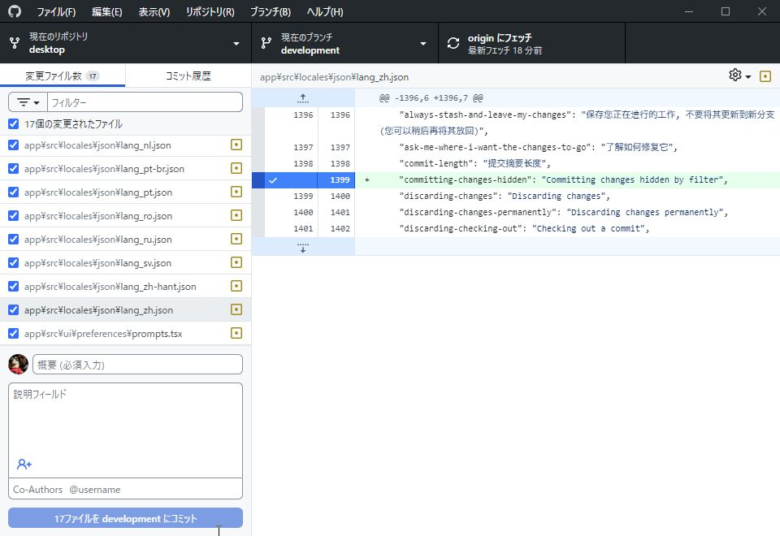

# [GitHub Desktop](https://desktop.github.com) Multilingal Platform

[GitHub Desktop](https://desktop.github.com/) is an open-source [Electron](https://www.electronjs.org/)-based
GitHub app. It is written in [TypeScript](https://www.typescriptlang.org) and
uses [React](https://reactjs.org/).

- This is an unofficial binary distribution of a multi-language platform version. Currently supported languages ​​are English, Japanese, Simplified Chinese, Traditional Chinese and Korean.
- ここでは非公式マルチランゲージプラットホーム バージョンのバイナリー配布を行っています。現在の対応言語は英語、日本語、簡体字、繫体字、ハングルです。
- 这里我们提供了多语言平台版本的非官方二进制分发版。目前支持的语言有英语、日语、简体中文、繫体中文、韩语。
- 여기에서는 비공식 멀티 랭귀지 플랫폼 버전의 바이너리 배포를 실시하고 있습니다. 현재의 대응 언어는 영어, 일본어, 간체 중국어, 번체 중국어, 한국어.

## Where can I get it Multilingal Platform?
 - [macOS(x64)](https://github.com/yasuking0304/desktop/releases/download/original-3.7.0/GitHub.Desktop-x64.zip)  
    For the MacOS version, please execute the included "setenv_lang_macos.sh" after installation.
You only need to run it once.

 - [Windows(x64)](https://github.com/yasuking0304/desktop/releases/download/original-3.7.0/GitHubDesktopSetup-x64.exe)
 - [Linux(x64-AppImage)](https://github.com/yasuking0304/desktop/releases/download/original-3.7.0/GitHubDesktop-linux-x86_64-3.7.0.AppImage)

[Click here for details (This site is only available in Japanese)](https://github.com/yasuking0304/desktop/wiki)

<picture>
  <source
    srcset="./docs/assets/github-desktop-dark.jpg"
    media="(prefers-color-scheme: dark)"
  />
  
</picture>

## Where can I get it?

Download the official installer for your operating system:

 - [macOS](https://central.github.com/deployments/desktop/desktop/latest/darwin)
 - [macOS (Apple silicon)](https://central.github.com/deployments/desktop/desktop/latest/darwin-arm64)
 - [Windows](https://central.github.com/deployments/desktop/desktop/latest/win32)
 - [Windows machine-wide install](https://central.github.com/deployments/desktop/desktop/latest/win32?format=msi)

Linux is not officially supported; however, you can find installers created for Linux from a fork of GitHub Desktop in the [Community Releases](https://github.com/desktop/desktop#community-releases) section.

### Beta Channel

Want to test out new features and get fixes before everyone else? Install the
beta channel to get access to early builds of Desktop:

 - [macOS](https://central.github.com/deployments/desktop/desktop/latest/darwin?env=beta)
 - [macOS (Apple silicon)](https://central.github.com/deployments/desktop/desktop/latest/darwin-arm64?env=beta)
 - [Windows](https://central.github.com/deployments/desktop/desktop/latest/win32?env=beta)
 - [Windows (ARM64)](https://central.github.com/deployments/desktop/desktop/latest/win32-arm64?env=beta)

The release notes for the latest beta versions are available [here](https://desktop.github.com/release-notes/?env=beta).

### Past Releases
You can find past releases at https://desktop.githubusercontent.com. After installation of a past version, the auto update functionality will attempt to download the latest version. 

### Community Releases

There are several community-supported package managers that can be used to
install GitHub Desktop:
- Windows users can install using [winget](https://docs.microsoft.com/windows/package-manager/winget/) or [Chocolatey](https://chocolatey.org/):

  ```shell
  winget install github-desktop
  ```

  ```shell
  choco install github-desktop
  ```
- macOS users can install using the [Homebrew](https://brew.sh/) package manager:

  ```shell
  brew install --cask github
  ```

Installers for various Linux distributions can be found on the
[`shiftkey/desktop`](https://github.com/shiftkey/desktop) fork.

## Is GitHub Desktop right for me? What are the primary areas of focus?

[This document](https://github.com/desktop/desktop/blob/development/docs/process/what-is-desktop.md) describes the focus of GitHub Desktop and who the product is most useful for.

## I have a problem with GitHub Desktop

Note: The [GitHub Desktop Code of Conduct](https://github.com/desktop/desktop/blob/development/CODE_OF_CONDUCT.md) applies in all interactions relating to the GitHub Desktop project.

First, please search the [open issues](https://github.com/desktop/desktop/issues?q=is%3Aopen)
and [closed issues](https://github.com/desktop/desktop/issues?q=is%3Aclosed)
to see if your issue hasn't already been reported (it may also be fixed).

There is also a list of [known issues](https://github.com/desktop/desktop/blob/development/docs/known-issues.md)
that are being tracked against Desktop, and some of these issues have workarounds.

If you can't find an issue that matches what you're seeing, open a [new issue](https://github.com/desktop/desktop/issues/new/choose),
choose the right template and provide us with enough information to investigate
further.

## The issue I reported isn't fixed yet. What can I do?

If nobody has responded to your issue in a few days, you're welcome to respond to it with a friendly ping in the issue. Please do not respond more than a second time if nobody has responded. The GitHub Desktop maintainers are constrained in time and resources, and diagnosing individual configurations can be difficult and time consuming. While we'll try to at least get you pointed in the right direction, we can't guarantee we'll be able to dig too deeply into any one person's issue.

## How can I contribute to GitHub Desktop?

The [CONTRIBUTING.md](./.github/CONTRIBUTING.md) document will help you get setup and
familiar with the source. The [documentation](docs/) folder also contains more
resources relevant to the project.

If you're looking for something to work on, check out the [help wanted](https://github.com/desktop/desktop/issues?q=is%3Aissue+is%3Aopen+label%3A%22help%20wanted%22) label.

## Building Desktop

To setup your development environment for building Desktop, check out: [`setup.md`](./docs/contributing/setup.md).

## More Resources

See [desktop.github.com](https://desktop.github.com) for more product-oriented
information about GitHub Desktop.

See our [getting started documentation](https://docs.github.com/en/desktop/overview/getting-started-with-github-desktop) for more information on how to set up, authenticate, and configure GitHub Desktop.

## License

**[MIT](LICENSE)**

The MIT license grant is not for GitHub's trademarks, which include the logo
designs. GitHub reserves all trademark and copyright rights in and to all
GitHub trademarks. GitHub's logos include, for instance, the stylized
Invertocat designs that include "logo" in the file title in the following
folder: [logos](app/static/logos).

GitHub® and its stylized versions and the Invertocat mark are GitHub's
Trademarks or registered Trademarks. When using GitHub's logos, be sure to
follow the GitHub [logo guidelines](https://github.com/logos).
